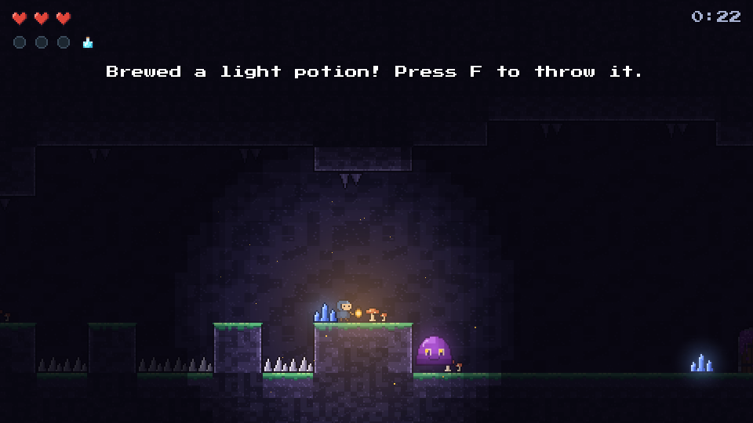

# Spore Lantern

A small 2D platformer about carrying a light through a dark cave, built on the
[glgame2d](https://github.com/VarunVF/glgame2d) engine as an external dependency.

You are a lantern-bearer. Collect three glowing spores, brew them into a light
potion, and throw it at the slime that seals the exit.



## Engine

| | |
| --- | --- |
| Repository | https://github.com/VarunVF/glgame2d |
| Fetched ref | `main` (the repository has no tags) |
| **Commit used** | **`58312b47956e48200a6422834cc1c0a43204a057`** ("Update GLCall macro") |

The engine is fetched with CMake `FetchContent`; nothing from it is vendored or
modified here, and no local override is used. CMake prints the commit it
fetched (`-- glgame2d commit: ...`). Because the ref is a branch, a later
checkout may fetch a newer commit; the one above is what this game was built
and tested against.

## Build

Requirements: CMake 3.16+, a C++23 compiler (tested with GCC 13.3), git, OpenGL 3.3,
and on Linux the GLFW build dependencies:

```bash
sudo apt install libwayland-dev libxkbcommon-dev xorg-dev
```

Then:

```bash
cmake -S . -B build
```

```bash
cmake --build build -j
```

```bash
./build/spore-lantern
```

The first configure downloads the engine and its dependencies (GLFW, GLM,
nlohmann_json) as full git clones. Expect a few minutes and about 500 MB in
`build/_deps`.

Options: `--fullscreen`, `--size 1920x1080`, `--mute`.

A build from an empty build directory was verified at the end of development:
configure 2 min 29 s (all downloads), compile 29 s with 16 jobs, no warnings
with `-Wall -Wextra`, and the scripted playthrough passed on the result.

## Controls

| Key | Action |
| --- | --- |
| `A` / `D` or arrow keys | move |
| `Space` / `W` / `Up` | jump (hold for a higher jump) |
| `E` | brew a light potion (needs 3 spores) |
| `F` | throw the potion the way you face; running throws it further |
| `R` | go back to the last shrine save |
| `Enter` | confirm on title, win and lose screens |
| `N` | new game on the title screen (erases the save) |
| `Esc` | pause; quit from the title screen |
| `F3` / `F4` / `F5` | debug overlay / coarse lighting / draw the map with the engine's `Tilemap::render()` |

## How it plays

- **Spores.** Three of them, each floating a little above the ground: one in
  the first cave, one at the end of the upper gallery (climb the stone steps in
  the big chamber from their far end), one over the spike pit.
- **Brew and throw.** With three spores, `E` makes one potion. `F` throws it in
  an arc. It bursts on the first thing it touches, or after 2 seconds.
- **The slime** patrols the last chamber and seals the exit door. A burst close
  to it destroys it. It only chases you once you are down on its floor, so the
  ledge above is a safe place to throw from.
- **A miss is not the end.** If the potion bursts away from the slime, the
  spores grow back where they were.
- **Hearts.** You have three. Spikes and the slime take one each. Your lantern
  shrinks as you lose them. At zero you lose and restart from the last shrine
  (or the cave entrance).
- **Shrine.** Touching it heals you and writes `save.txt` (position, spores,
  potion, hearts, whether the slime is gone, time, losses). The file is read
  when the game starts.
- **Exit.** Touch the open door to win. `Enter` then resets the cave and
  erases the save.

`save.txt` is written next to the executable (`build/save.txt`).

## Repository layout

| Path | What |
| --- | --- |
| `src/` | the game (C++23, about 2,300 lines) |
| `assets/` | generated art, sounds, the level, and the font |
| `tools/make_art.py` | generates every image in `assets/gfx` |
| `tools/make_audio.py` | synthesises every sound in `assets/sfx` |
| `tools/build_level.py` | turns `assets/level/level.txt` into the Tiled map (solid tile layer + decoration object layer) and the baked level image |
| `tests/` | a scripted full playthrough |
| `SCOPE.md` | what was planned before coding |
| `FRICTION.md` | where the engine got in the way |
| `ASSETS.md` | asset sources and licences |

The tools need Python 3 with Pillow and are only needed to regenerate assets;
their output is committed. After editing `level.txt`, run
`python3 tools/build_level.py` (and run `make_art.py` first if the art changed).

## Testing

```bash
tests/run_playtest.sh
```

This plays `tests/full_run.txt` (start, three spores, shrine save, brew,
throw, slime, door, win, reset) against the built game inside `xvfb-run` and
checks the game's log for each milestone. The simulation runs at a fixed
120 Hz step, so the script replays identically every time.

## Design changes made because of the engine

Recorded here as the task asked. Details and measurements are in `FRICTION.md`.

1. **The level is ASCII, not a Tiled project.** The engine's tilemap exposes
   no tile, object or property data, so the game cannot read spawn points,
   spores or spikes from a map. `level.txt` is the source of truth and a
   script generates the Tiled JSON from it: a solid tile layer, and an object
   layer of non-solid tile objects for the decoration.
2. **The map is drawn as one baked image**, not with `Tilemap::render()`,
   which draws every tile and object of the map (about 890) every frame at a
   real cost per sprite. `F5` switches to the engine's rendering to compare.
3. **Darkness is a grid of 16 px squares in 8 alpha steps** rather than smooth
   light, because sprites have no tint, alpha or blend mode. Crystals and the
   slime glow but do not light their surroundings, to save sprites.
4. **The slime is not a physics entity.** Engine collision only handles bodies
   up to one tile in size, so the 60×44 slime hops along a flat floor with its
   own code.
5. **The potion does not spin** (no sprite rotation) **and particles shrink
   instead of fading** (no per-sprite alpha).
6. **The title is 32 px**, the largest size at which the font fits the
   engine's fixed 512×512 atlas.
7. **Ambience loops by restarting an overlapping file**, and all volumes are
   baked into the sound files, because the mixer can only start a sound.
8. **No one-way platforms**: the stone steps are solid and are climbed from
   their open side.

## Known limits

- One level. A full run takes about a minute once you know the way.
- Tested on Linux/X11 only (GCC 13.3, Mesa). The code is portable C++ and CMake,
  but Windows and macOS builds were not tried.
- Performance was measured under a software renderer in a virtual display, not
  on a GPU: about 13–15 ms per frame at roughly 400 sprites.
- Sound was generated and loaded successfully but checked by reading the
  synthesis code and levels, not by ear.
- The game was verified by scripted playthroughs and screenshots, not by a
  person at a keyboard, so difficulty tuning is an estimate.

## Licence

Game code and generated assets: see `ASSETS.md` for the assets. The font is
under the SIL Open Font License. The engine has no licence file of its own
upstream (only `THIRD_PARTY_LICENSES.md`); it is fetched at build time and not
redistributed here.
